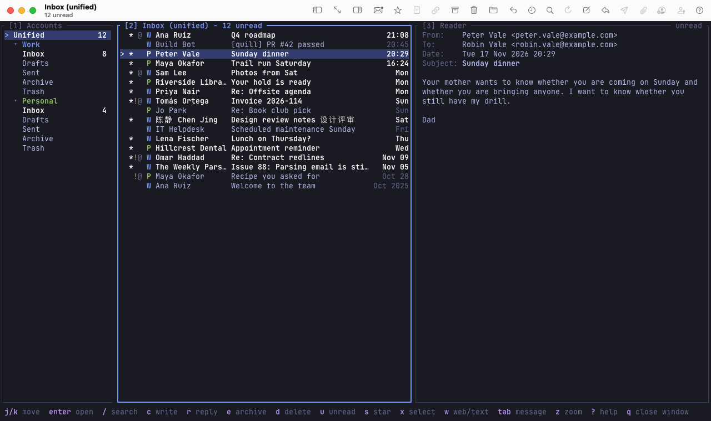
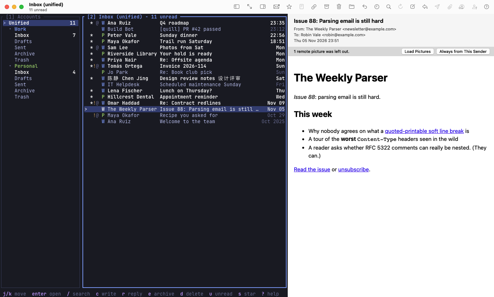
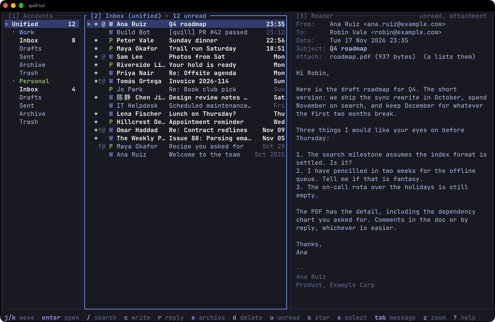
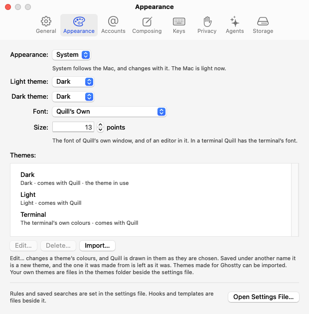

<p align="center">
  
</p>

<h1 align="center">Quill</h1>

<p align="center"><strong>Mail for your Mac, from the keyboard.</strong></p>

<p align="center">Early access · macOS 13 or later · free, with the source</p>



Quill is a mail program for people who would rather not reach for the mouse. It is a real Mac app, with a window, menus, a toolbar, notifications and a Settings window, and at its centre is a terminal that it draws your mail in. Every action is a key, and every key is yours to change.

The same program runs in a terminal of your own, over the same mailbox: `quill tui`.

> **Early access.** Quill is version 0.1. It works, and it is used for real mail, but it is young: there are rough edges, parts of it have only met test servers, and there is no signed download yet, so for now you build it from the source. See [what to expect](#early-access-what-to-expect).

## What it does

**Everything from the keyboard.** `j` and `k` to move, `r` to reply, `e` to archive, `/` to search. A palette (`:`) finds any command or mailbox by a few letters, and `K` lists every key. Prefer mutt's keys? They are a setting. Prefer your own? Press them into Settings > Keys. The mouse works too, when you want it.

**All your accounts, one inbox.** Gmail and Google Workspace, Microsoft 365 and Outlook.com, Exchange on your own servers, and any IMAP or POP3 server, side by side or together in a unified inbox. Google and Microsoft accounts sign in at the provider, in your browser; Quill never sees that password.

**Your mail is on your Mac.** Quill keeps a copy of your mail on your own disk, so opening a message and searching years of them are quick, and work with no connection. What you do offline is carried out when you are back. Folders can live "On This Mac" alone, off the server altogether.

**Mail as text, or as it was sent.** Read in the terminal, where HTML mail is laid out as clean styled text, or flip to a web reading pane (`w`) that shows the message as its sender made it. Either way remote pictures stay unloaded until you ask, so nobody learns that you opened their mail. Drag over a message's words to copy them, or save the message as text, as a web page or as a `.eml` file any mail program opens.

**Write the way you write.** Quill's own editor writes Markdown, and has spell check, templates, addresses offered as you type and attachments by drag and drop. Or write in your own Vim, nano, pico or mg, with your own settings, right in the message's pane. A sent message can be taken back for a few seconds, or told to go later.

**Stay on top of it.** Search with filters (`from:ana is:unread "exact phrase"`) and save the searches you repeat. Snooze a message until tomorrow morning. Group conversations. Select many and act once. Unsubscribe from a list with one key. Answer an invitation from the message, and `U` takes back what you just did.

**Mail that sorts itself.** Rules file, delete or mark mail as it arrives: a few plain lines each in a file of their own, matching who it is from, its subject, the words in it or the list it came through. Try a rule first and Quill shows the mail it would change before anything moves; a delete is only ever a move to the Trash; and everything a rule did is written down and can be taken back. One key switches them all off.

**At home on a Mac.** New mail is pushed to Quill where the server can, and announced; the Dock shows what is unread; `mailto:` links open in Quill. Attachments open beside your mail in Quick Look, and sound and video play in a pane. It follows the Mac between light and dark, with a theme for each, and imports any theme made for Ghostty.

**Yours to script.** Quill has a command line: `quill search`, `read`, `move`, `archive`, `delete`, `draft reply`, `send`, each with `--json`, a dry run, and an undo, for shell scripts, scheduled jobs and tools of your own. What the commands may do is yours to set, and sending is off until you switch it on. A hook hands the message you are on to a program of your own.

**AI agents, only if you ask.** Quill has no AI in it, and sends your mail to nobody. If you use an AI agent and want it to help with your mail, two things are there to set up, and neither does anything until you do:

- **A skill**, which you install into your agent's program yourself (`quill skill install`, for Claude Code, Codex, Gemini CLI, Cursor and others). It teaches the agent the command line above, and nothing more.
- **MCP**, which is off until you switch it on in Settings. Quill then offers the same actions as tools to an agent's program, while Quill is running, over a connection only your own programs can open. Nothing listens on the network.

Either way, what may be done is yours to say (look, organize, delete to the trash, draft, send), every change is logged and can be taken back, what is sent can wait for your OK, and one command stops it all. [The manual](docs/manual.md#agents) has the whole of it.

**Private.** Quill has no servers of its own, no analytics and no tracking. Your mail goes between your Mac and your mail providers and nowhere else, and your passwords are in the macOS Keychain. [PRIVACY.md](PRIVACY.md) says exactly what it keeps and what it connects to.

## A look around

**Mail as it was sent.** Press `w` and the message opens in a web pane beside the list, with remote pictures left out until you ask for them. While Quill is dark the mail is too: its white backgrounds dark and its text light, its pictures untouched (`W` shows it as it was sent).



**In a terminal of your own.** The same program, the same mail and the same keys: here `quill tui` in Ghostty.



**Settings, as on any Mac.** A settings window for what you change most, and a plain file behind it for everything else.

<p align="center">
  
</p>

## Get it

There is no download yet: Quill is built from the source. You need macOS 13 or later, Xcode's command line tools (`xcode-select --install`) and a stable Rust (1.98 or later, from [rustup](https://rustup.rs)).

```sh
git clone https://github.com/msharpe248/quill.git
cd quill
app/build-app.sh
open target/app/Quill.app
```

The first build takes a while. Quill opens on the form for adding an account. Quill > Install Command Line Tool then puts `quill` on your `PATH`, for the command line below.

**Just looking?** The demo opens an invented mailbox and touches no account of yours:

```sh
target/app/Quill.app/Contents/MacOS/Quill --demo
```

**In a terminal instead?** `cargo run --release -- tui` (add `--demo` to look around). It is at its best in Ghostty or Kitty; other terminals work with fewer key combinations.

Two things to know about a build of your own:

- **macOS asks about your saved passwords after every build**, because an unsigned build is a new program to the Keychain each time. Signing with an identity of your own stops that; [the manual](docs/manual.md#adding-an-account) says how.
- **Signing in with Google needs a Google client of your own**, since Quill's registration with Google is not in the source; [docs/oauth.md](docs/oauth.md) walks through it. A Gmail app password works without one. Microsoft accounts need nothing extra.

## The first five minutes

| Key | Does | Key | Does |
|---|---|---|---|
| `j` / `k` | Down, up | `enter` | Open the message |
| `c` | Write a message | `r` | Reply |
| `R` | Reply to all | `f` | Forward |
| `e` | Archive | `d` | Delete |
| `s` | Star | `u` | Mark unread |
| `m` | Move to a folder | `b` | Snooze |
| `x` | Select, to act on several | `U` | Take back what you just did |
| `/` | Search | `w` | Web reading pane, or text |
| `:` | The palette: any command | `tab` | Between the list and the message |
| `?` | Help for where you are | `K` | Every key there is |

The keys for where you are stand along the bottom of the window, and everything is in the menus as well. `q` closes the window and leaves Quill fetching mail; `Q` quits.

## Documentation

| | |
|---|---|
| [The manual](docs/manual.md) | Everything Quill does: accounts, keys, reading, writing, search, rules, the settings file, themes |
| [Building and working on Quill](docs/development.md) | The build scripts, the checks, how the code is laid out |
| [Signing in with Google and Microsoft](docs/oauth.md) | What a provider's sign-in needs, and how to register a client of your own |
| [Where Quill is going](docs/roadmap.md) | What is next, what is missing, and the plan Quill started from |
| [Quill for agents](Quill%20Agents%20Spec.md) | The design of the command line, the skill and the opt-in MCP server: what may be done through them, and what never can |
| [DECISIONS.md](DECISIONS.md) | Why each thing is the way it is, and what was and was not verified |
| [The spec](Quill%20Terminal%20Email%20Client%20Spec.md) | The original design |

## Early access: what to expect

- **It is young.** Quill is used for real mail, but by few people and not for long. Settings, keys and commands may still change between versions.
- **Some of it has only met test servers.** IMAP with a password, and Gmail signed in to with Google, have been used against the real thing. Microsoft 365, Exchange and POP3 providers have so far been tested only against servers run locally and stand-ins written from the providers' documentation. [The roadmap](docs/roadmap.md#not-yet-tried-on-the-real-thing) has the list. If you use one of these, your report matters more than most.
- **There is no signed download.** A notarized disk image and a Homebrew cask are next; until then, see "Get it".
- **The command line, the skill and MCP are new.** They are a day old, and have been tried on the demo mailbox, not yet on a real account or with a real agent's program. Start with sending off or held.
- **Apple silicon only, so far.** An Intel Mac has not been tried.
- **It acts on your real mail.** Quill is careful: deleting moves a message to the account's Trash, where it can be put back. But it is young software. The one thing to know before you start: mail you move into a folder "On This Mac" is taken off the server and then exists only on your Mac, as the name says. Keep a backup of your Mac if you use those.

## Reporting a problem, or asking for something

Open an issue: <https://github.com/msharpe248/quill/issues>. Bugs, things that confused you and things you miss are all welcome; in early access they are the point.

For a bug, what helps most:

- What you did, what you expected, and what happened instead.
- Whether it was the app or `quill tui` in a terminal (and which terminal).
- The kind of account: Gmail, Microsoft 365, Exchange, IMAP or POP3. Never the address.
- `quill --version` and your version of macOS.
- A picture of the window, if it shows the problem and nothing private.

Please never paste a password, a token, or mail you would not publish. If what you have found is a security problem, say only that in the issue, and ask how to send the details.

If you would like to change Quill yourself, open an issue first so the change can be talked over. [Building and working on Quill](docs/development.md) has what you need to start.

## How it is made

A Swift shell supplies the window, menus, sheets and viewers, and embeds a terminal (libghostty). A Rust core draws the mail UI in that terminal with Ratatui and does all the mail work: the protocols, the local store, sync, search. The two talk over a small JSON bridge with a checked-in schema. The core has no `unsafe` code of its own, and its tests start a real mail server (Dovecot) to read from, and check whole screens of the UI against snapshots of what they should be.

## Licence

Quill is free to use, copy, change and share, under the MIT License with the Commons Clause: the one thing you may not do is sell it. The whole of it is in [LICENSE](LICENSE), and the terms Quill is given out on are in [TERMS.md](TERMS.md). That makes Quill source-available and not "open source" as the Open Source Initiative defines the term.
